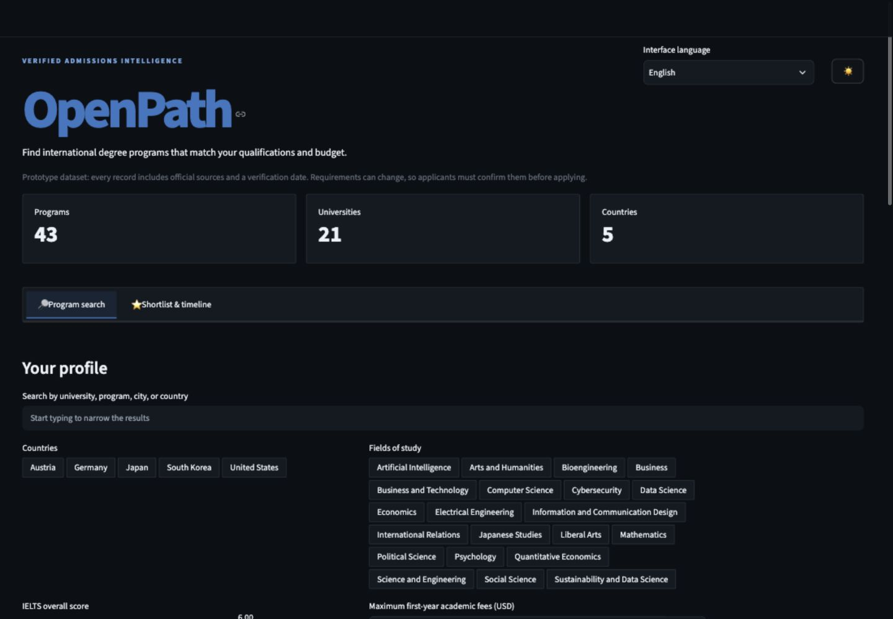
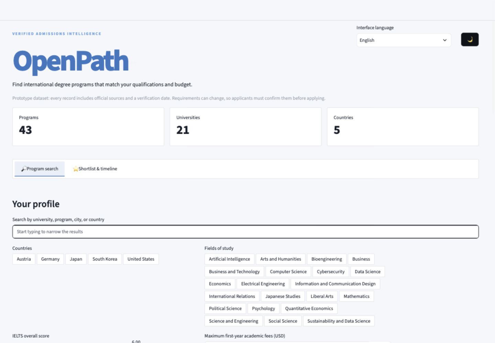
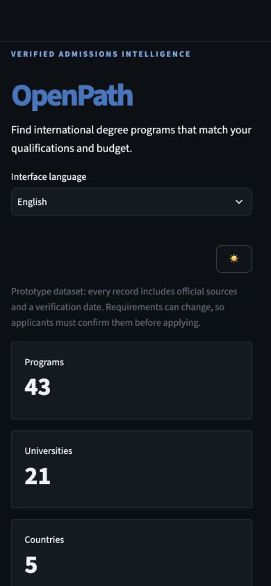
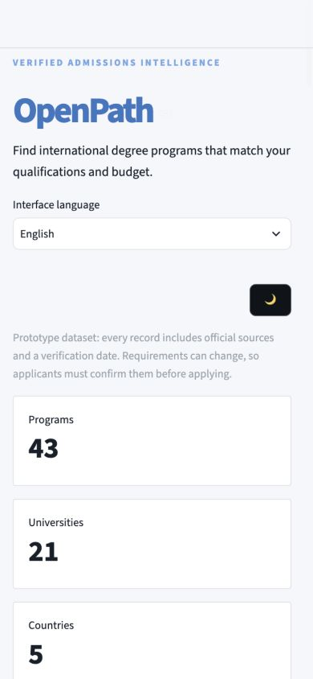

# OpenPath

OpenPath helps international applicants compare degree programs using admission requirements, tuition costs, scholarships, and verified official sources.

The interface is available in English, Russian, Ukrainian, Spanish, German, and Japanese. University names and source-derived admissions text remain in English to preserve the wording of official information.

## Project status

The current catalog compares 43 undergraduate programs across 21 universities in Japan, Austria, the United States, Germany, and South Korea. Programs can be searched by name or location and filtered by language, field, country, test requirements, and budget.

## Screenshots

### Desktop — dark theme

### Desktop — light theme

Mobile themes

| Dark theme | Light theme |
| --- | --- |
|  |  |

## Current capabilities

- Filter programs by country, subject, IELTS score, SAT requirement, and budget.
- Compare tuition and estimated first-year costs in USD while preserving each university's published local currency.
- Distinguish merit scholarships, need-based aid, and tuition waivers.
- Classify every result as Eligible, Conditional, or Not eligible and explain why.
- Build a persistent personal shortlist, compare selected programs, and export it as Excel.
- Generate an application timeline that separates official dates from planning milestones.
- Track a compact, requirement-aware application checklist for shortlisted programs.
- Link every important value to an official source.
- Display when each record was last verified.
- Explain missing or uncertain data instead of inventing values.

## Data methodology

Every record stores separate official sources for admissions, fees, and the academic program, together with the date it was verified. Tuition is kept separate from total first-year academic fees because scholarships often cover only tuition.

See the [data dictionary](docs/data_dictionary.md) for definitions and collection rules.

The first usability study and the changes made from participant feedback are documented in the [user testing report](USER_TESTING.md).

## Technology

- Python
- pandas
- Streamlit
- Plotly

